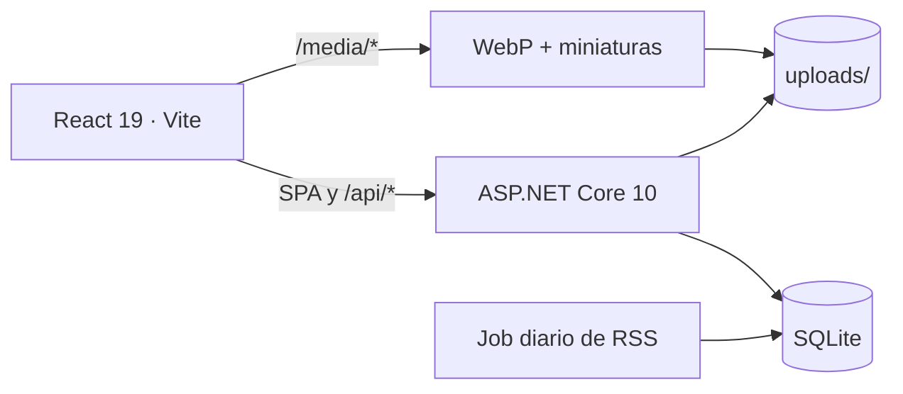

# Fashion App

App web personal de moda: subí fotos de tus prendas, completá sus datos a mano
y convertí el guardarropa en la base para armar outfits y leer un resumen diario
de noticias relacionado con lo que ya tenés.

Proyecto de portfolio: un solo dueño, un solo contenedor, sin cuentas. La API
.NET sirve la SPA compilada y guarda todo en SQLite + archivos dentro de un
único volumen persistente.

## Capturas

Las imágenes se generan con el spec de Playwright
(`frontend/tests/screenshots.spec.ts`) sobre datos sembrados por API: 14 prendas,
un digest de 8 notas y tres outfits.

| Hoy | Guardarropa | Outfits |
|---|---|---|
|  |  |  |

| Hoy (mobile) | Guardarropa (mobile) | Outfits (mobile) |
|---|---|---|
|  |  |  |

> Las fotos de las prendas son assets de demo genéricos, generados
> programáticamente. Antes de publicar el portfolio conviene reemplazarlos por
> fotos con licencia (ver **Límites conocidos**).

### Flujo de alta en video

[](docs/screenshots/upload-flow.webm)

Video WebM del flujo completo **subir foto → analizar → confirmar**, grabado con
el backend aislado y el analizador fake. Se regenera solo a pedido, igual que
las capturas:

```bash
cd frontend
CAPTURE=1 pnpm exec playwright test tests/upload-flow.spec.ts
```

```powershell
# PowerShell
cd frontend
$env:CAPTURE='1'
pnpm exec playwright test tests/upload-flow.spec.ts
```

El spec está apagado salvo `CAPTURE=1` y **no corre en CI**: es una grabación de
portfolio, no un test de regresión.

## Features

- **Alta manual y por lotes.** La foto se normaliza a WebP (EXIF eliminado,
  miniatura de 400 px) y vos completás nombre, categoría, color, temporada,
  formalidad y etiquetas. Podés elegir varias fotos y guardarlas juntas.
- **Guardarropa filtrable y editable.** Grilla responsive con filtros por categoría, color
  y temporada, paginación acumulativa y muestra del color real de cada prenda.
  Cada prenda se puede eliminar con confirmación; los outfits guardados conservan su foto.
- **Outfits con prendas reales.** Combinaciones por reglas según ocasión y clima,
  collage vertical tipo maniquí, edición manual (nombre, ocasión, favorito y
  composición) y eliminación con confirmación.
- **Portada Hoy.** Digest diario desde feeds RSS, con el resumen del feed,
  etiquetas inferidas por palabras clave, links a las fuentes y las prendas del
  guardarropa que combinan con cada noticia. La respuesta usa `ETag`/`304` y caché privada.
- **Demo pública de solo lectura.** Datos sembrados, feeds fake, costo cero y
  todas las escrituras responden `403`.
- **Límites y abuso controlados.** Rate limit por IP y errores `ProblemDetails` en español.
- **Privacidad por diseño.** El token es un secreto compartido, las imágenes no
  salen del servidor y la portada no expone prendas a requests sin token cuando
  la instancia personal lo exige.

## Stack

| Capa | Tecnología |
|---|---|
| Backend | .NET 10, Minimal APIs, EF Core 10, SQLite |
| Frontend | Vite 8, React 19, TypeScript, Tailwind 4, TanStack Query 5, React Router 7 |
| Imágenes | Magick.NET (WebP, EXIF eliminado, miniaturas de 400 px) |
| Motor de outfits | Reglas deterministas + armonía de color, sin IA |
| Noticias | Feeds RSS/Atom + `BackgroundService` diario; resumen local con palabras clave |
| Infra | Docker multi-stage, volumen `/data`, GitHub Actions |
| Tests | xUnit + `WebApplicationFactory`, Vitest + Testing Library, Playwright, Lighthouse |

## Arquitectura



- **Un solo origen en producción:** la API sirve `index.html`, los assets con
  hash y `/api/*` + `/media/*` desde el mismo puerto (`8080` en el contenedor).
- **Una sola raíz de datos:** `DATA__ROOT` deriva `fashion.db` y `uploads/`. La
  demo usa una raíz propia (`DATA__ROOT/demo`) y el arranque falla si intenta
  apuntar a la base o a los uploads personales.
- **Las reglas componen, el backend valida:** composiciones, ids y etiquetas se
  revalidan antes de persistir. El motor es determinista y no llama a ningún
  proveedor externo.

Diagrama completo, decisiones y topología de deploy:
[docs/architecture.md](docs/architecture.md).

## Cómo correr local

Requisitos:

- **.NET 10 SDK** (`dotnet --version`)
- **Node 22+** y **pnpm** (`node --version`, `pnpm --version`)
- Chromium de Playwright, solo para el E2E:
  `pnpm exec playwright install chromium`

### 1. Backend

Desde la raíz del repositorio:

```powershell
# PowerShell
dotnet run --project backend/FashionApp.Api
```

> **Windows / Smart App Control:** si `dotnet run` falla con
> `Una directiva de Control de aplicaciones bloqueó este archivo`, usá el
> script que compila en Release y ejecuta el DLL directamente:
>
> ```powershell
> .\scripts\run-backend.ps1
> ```
>
> También podés desactivar Smart App Control en Seguridad de Windows, pero el
> script evita tocar esa configuración.

```bash
# Linux/macOS
dotnet run --project backend/FashionApp.Api
```

- API: `http://localhost:5210` (definido en
  `backend/FashionApp.Api/appsettings.Development.json`).
- Health check: `GET http://localhost:5210/api/health`.
- Datos: `data/fashion.db` y `data/uploads/` (fuera de git). Cambiá la raíz con
  `DATA__ROOT`.
- La app **no usa IA**: cada prenda se carga con datos manuales (nombre,
  categoría, color, temporada, formalidad y etiquetas). No hay claves de modelos
  ni costos de inferencia.
- El formulario de alta acepta **varias fotos a la vez**; cada una recibe su
  propio formulario y se guardan juntas con “Guardar todas”.
- La app lee automáticamente un `.env` en la raíz del repo (o hasta ocho
  carpetas arriba) al arrancar; las variables reales del entorno tienen
  prioridad. `.env.example` solo documenta `APP__TOKEN` y `DATA__ROOT`.
- En `Development`, `Digest__Provider=fake` devuelve ocho notas de ejemplo;
  para feeds reales usá `DIGEST__PROVIDER=rss` y `DIGEST__FEEDS__...`.
- Los outfits se generan con un **motor de reglas y armonía de color**; no hay
  proveedor externo ni cuota de IA.

### 2. Frontend

En otra terminal:

```bash
cd frontend
pnpm install
pnpm dev
```

- App: `http://localhost:5173`.
- Por defecto consume `http://localhost:5210`; para apuntar a otro backend:
  `VITE_API_URL=http://localhost:5210 pnpm dev`.

### 3. Modo demo

La demo siembra 14 prendas y un digest de 8 notas, usa una raíz propia y no
acepta escrituras:

```powershell
$env:DEMO__ENABLED='true'
dotnet run --project backend/FashionApp.Api
```

También se puede levantar todo con Docker: `docker compose up --build`
(app en `http://localhost:8080`). Ver [docs/architecture.md](docs/architecture.md).

## Tests y verificación

```bash
# Backend
dotnet test backend/FashionApp.sln

# Frontend: unitarios
cd frontend
pnpm vitest run

# Frontend: typecheck + build de producción
pnpm build

# Frontend: lint
pnpm lint

# E2E (levanta API aislada + Vite automáticamente)
pnpm exec playwright test
```

Playwright usa `.test-data` (SQLite + uploads) y lo borra al inicio de cada
run; nunca toca `data/`. Antes de correrlo, **detené cualquier backend o Vite
propio en los puertos 5210/5173**: el runner no reutiliza servidores existentes
(`reuseExistingServer: false`) para no mutar datos reales. La API de test corre
con feeds fake, sin token y con `Demo__Enabled=false`. Los specs cubren:

- **Guardarropa:** alta manual, lote de varias fotos, edición, cancelación,
  eliminación, rechazo de archivos > 10 MB y demo de solo lectura.
- **Outfits:** generar con reglas, guardar, crear a mano, renombrar y eliminar.
- **Hoy:** sembrar una prenda, regenerar el digest con `X-Admin-Secret` y
  verificar el hero, el link externo y la miniatura relacionada.

**Capturas de portfolio** (no corren en CI; `CAPTURE=1` las habilita):

```bash
cd frontend
CAPTURE=1 pnpm exec playwright test tests/screenshots.spec.ts
```

```powershell
# PowerShell
cd frontend
$env:CAPTURE='1'
pnpm exec playwright test tests/screenshots.spec.ts
```

Escribe seis PNG en `docs/screenshots/`: viewport desktop 1440×900 y mobile
390×844, con el PNG mobile a 2× (780×1688). La portada **Hoy** usa un viewport
más alto —1440×1100 desktop y 390×1050 mobile (PNG 780×2100)— para que se vea
completa la tira «En tu guardarropa»; el resto de las capturas conserva el
viewport estándar. Para que las notas no queden con bloques vacíos, el spec
intercepta `GET /api/digest/today` **solo durante la captura de Hoy** y asigna
`imageUrl` a las primeras tres notas usando imágenes demo de
`frontend/public/`; la API y el código de producción no cambian. Sin
`CAPTURE=1` el spec se salta.

## Variables de entorno

Las variables de .NET usan `Sección__Clave`. Las del front deben empezar con
`VITE_`.

| Variable | Default | Descripción |
|---|---|---|
| `DATA__ROOT` | `../../data` | Raíz única de datos; de ella derivan SQLite y uploads. |
| `APP__TOKEN` | vacío | Token estático de la instancia personal. Obligatorio en `Production` (salvo `APP__ALLOWANONYMOUS=true`). |
| `APP__ALLOWANONYMOUS` | `false` | Escape hatch explícito para una instancia personal sin token en `Production`. |
| `DEMO__ENABLED` | `false` | Modo demo: siembra datos, usa su propia raíz y rechaza escrituras con `403`. |
| `DEMO__DATAROOT` | `<DATA__ROOT>/demo` | Raíz de datos de la demo. No puede coincidir con la base ni los uploads personales. |
| `DIGEST__PROVIDER` | `rss` (`fake` en `Development`) | `rss` lee feeds reales; `fake` devuelve notas determinísticas sin red. |
| `DIGEST__FEEDS` | `[]` | Lista de `{ "Name", "Url" }` de feeds RSS/Atom. |
| `DIGEST__RUNAT` | `07:00` | Hora local del servidor del job diario. |
| `DIGEST__GENERATEONSTARTUP` | `true` | Genera el digest al arrancar si falta el de hoy. |
| `DIGEST__MAXITEMS` | `10` | Máximo de notas persistidas por digest. |
| `DIGEST__MAXAGEHOURS` | `48` | Descarta notas publicadas hace más de estas horas. |
| `DIGEST__ADMINSECRET` | vacío | Secreto de `POST /api/digest/refresh` (`X-Admin-Secret`). Vacío lo deshabilita. |
| `RATELIMITING__ENABLED` | `true` | Rate limit por IP en `/api/garments`, `/api/outfits/suggest` y `/api/digest/refresh`. |
| `RATELIMITING__PERMITLIMIT` | `60` | Solicitudes por minuto y por IP; el exceso responde `429` + `Retry-After`. Detrás de un proxy usa el primer `X-Forwarded-For` y, si falta, la dirección del socket. |
| `CONNECTIONSTRINGS__DEFAULT` | derivada de `DATA__ROOT` | Override de SQLite para CI/tests. |
| `STORAGE__ROOT` | `<DATA__ROOT>/uploads` | Override de la carpeta de imágenes. |
| `CORS__ALLOWEDORIGIN` | `http://localhost:5173` | Único origen permitido por CORS en desarrollo. |
| `VITE_API_URL` | `http://localhost:5210` | URL de la API usada en build/dev del front (`/` dentro del contenedor). |
| `ASPNETCORE_ENVIRONMENT` | `Production` (framework) | `Development` habilita datos locales; el perfil `dotnet run` lo setea solo. `Production` activa las validaciones de seguridad del contenedor. |

`APP__TOKEN` no es autenticación real: es un secreto compartido para una
instancia personal y así queda documentado.

## Deploy

El repositorio no ata el deploy a ningún proveedor. La app se puede ejecutar
como **un solo contenedor** con `docker compose up --build`: la API sirve la SPA
en el puerto `8080` y persiste SQLite e imágenes en el volumen `/data`.

La demo corre con feeds fake y es de solo lectura. La instancia personal se
activa con variables de entorno (`APP__TOKEN`, `DEMO__ENABLED=false`). No hay
claves de IA.

No hay configuración de hosting ni credenciales versionadas: elegí el host de
contenedores que prefieras y montá un volumen persistente en `/data`.

## Rendimiento

Presupuesto del diseño: **LCP < 2,5 s · INP < 200 ms · CLS < 0,1** en p75
móvil; lecturas de API p95 < 300 ms.

### Bundle del build de producción

Medido con `pnpm build` (Vite 8, React 19). Los nombres llevan hash y cambian
en cada build.

| Recurso | Tamaño | Gzip |
|---|---|---|
| JS de entrada (`index-<hash>.js`) | 287,73 KB | 91,05 KB |
| CSS (`index-<hash>.css`) | 32,33 KB | 6,55 KB |
| Chunk de `/hoy` (`TodayPage-<hash>.js`) | 7,54 KB | 2,43 KB |
| Cliente API compartido (`api-<hash>.js`) | 10,81 KB | 3,85 KB |
| Chunk de `/guardarropa` | 25,45 KB | 7,26 KB |
| Chunk de `/outfits` | 32,78 KB | 8,27 KB |
| Labels compartidos (`garmentLabels-<hash>.js`) | 1,26 KB | 0,49 KB |
| `index.html` | 0,65 KB | 0,38 KB |

La primera carga de `/` transfiere el JS de entrada + el chunk de Hoy + el
cliente API: unos **97,3 KB gzip** de JavaScript y 6,55 KB gzip de CSS. El
guardarropa y los outfits se cargan bajo demanda.

### Lighthouse móvil

Medición local sobre el build de producción real: `pnpm build`,
`dotnet publish -c Release` y **después** copia de `dist/` al `wwwroot` del
publish; la app publicada corre en `Production` con la demo sembrada.
Lighthouse 13.6.0, preset móvil por defecto (red y CPU simuladas), tres
corridas sobre `/`. El comando exacto, el hardware y los flags están en
[docs/metrics/README.md](docs/metrics/README.md); los JSON crudos de las tres
corridas quedan versionados en `docs/metrics/`.

| Métrica | Mediana | Rango de las 3 corridas | Presupuesto |
|---|---|---|---|
| Performance score | 93 | 93–93 | — |
| LCP | 3,21 s | 3,14–3,22 s | < 2,5 s |
| TBT (proxy de laboratorio de INP) | 53 ms | 42–55 ms | — |
| CLS | 0,060 | 0,060–0,060 | < 0,1 |
| Speed Index | 1,59 s | 1,56–1,62 s | — |
| FCP | 0,96 s | 0,90–0,96 s | — |

- **INP no se midió**: es una métrica de campo (requiere interacción real). En
  laboratorio se reporta **TBT** como proxy; no se inventa un valor de INP.
- **El LCP quedó por encima del presupuesto de 2,5 s** en este entorno. Los
  JSON de Lighthouse identifican el subtítulo de la portada como elemento LCP
  en las tres corridas. El *breakdown* observado (TTFB 9–21 ms y render delay
  433–460 ms) no explica por sí solo el LCP simulado de 3,1–3,2 s: la causa
  (hero renderizado por el cliente después de la consulta del digest / trabajo
  de JS bajo throttling simulado) queda como **hipótesis a validar**, no como
  un hecho medido.
- El **CLS** dio 0,060 en las tres corridas de esta medición.
- Los números dependen de hardware, red y carga de la máquina. No son una
  medición de campo ni de usuarios reales.

### Seguimiento

El LCP fuera de presupuesto tiene una tarea de seguimiento abierta en
[docs/perf-followup.md](docs/perf-followup.md): precargar/renderizar el hero de
Hoy antes y estabilizar su altura, con una medición antes/después usando el
mismo comando de Lighthouse. No se optimizó código de performance en la Fase 4.

## Límites conocidos

- **Sin hosting configurado.** El repo no ata el deploy a ningún proveedor; el
  `Dockerfile` y `docker-compose.yml` alcanzan para correrlo en cualquier host de
  contenedores con un volumen persistente en `/data`.
- **Imagen Docker no construida acá.** No hay Docker disponible. Sí se validó
  `pnpm build`, `dotnet publish` y un smoke de producción local con la SPA en
  `wwwroot`, `/api/health`, `/api/digest/today`, `/media/*` y el fallback de
  rutas. Comandos y resultados reales en [docs/smoke.md](docs/smoke.md).
- **Fotos de demo genéricas.** Los assets del manifiesto son placeholders
  generados con Magick.NET y llevan la palabra «Demo» impresa. Reemplazarlos
  por fotos con licencia antes de un portfolio público.
- **Demo con feeds fake.** La demo local usa notas de ejemplo para tener costo
  cero; los feeds reales se configuran con `DIGEST__FEEDS`.
- **Token, no autenticación.** `APP__TOKEN` es un secreto compartido de un solo
  usuario; no hay cuentas, sesiones ni permisos por usuario.
- **SQLite y una sola instancia.** No hay escritura concurrente multi-nodo ni
  escalado horizontal; el volumen vive en una región y cada reinicio conserva
  los datos.
- **Métricas de laboratorio y LCP fuera de presupuesto (aceptado).** INP no
  está medido y el LCP local (3,21 s) supera el presupuesto de 2,5 s. Lighthouse
  no reemplaza una medición de campo. La Fase 4 cierra con esa deuda
  **explícitamente aceptada** y el seguimiento accionable queda en
  [docs/perf-followup.md](docs/perf-followup.md); no se reescribió el hero en
  esta ola.
- **CI en GitHub Actions.** El workflow versionado corre backend, frontend y E2E
  en cada push y pull request.

## Estructura del repositorio

```
.
├── backend/
│   ├── FashionApp.Api/          API .NET, dominio, features, infraestructura
│   │   ├── Domain/              Garment, Outfit, Digest
│   │   ├── Features/            endpoints de garments, outfits, digest y security
│   │   └── Infrastructure/      EF Core, storage, feeds, demo, rate limit
│   └── FashionApp.Tests/        xUnit + WebApplicationFactory
├── frontend/
│   ├── src/                     React 19 + Vite
│   │   ├── features/            digest (Hoy), wardrobe, outfits
│   │   └── lib/                 cliente API y tipos
│   └── tests/                   Playwright E2E + capturas de portfolio
├── docs/
│   ├── architecture.md          diagramas y decisiones técnicas
│   ├── metrics/                 JSON de Lighthouse y entorno de medición
│   ├── smoke.md                 smoke de producción local (resultados reales)
│   ├── perf-followup.md         deuda aceptada de performance del hero de Hoy
│   ├── plan-fase-*.md           planes de implementación
│   ├── Fashion App.md           spec y bitácora
│   └── screenshots/             capturas desktop y mobile
├── .github/workflows/ci.yml     backend + frontend + e2e
├── Dockerfile                   imagen multi-stage (Node + .NET)
├── docker-compose.yml           demo local con volumen
└── README.md
```

## API

<details>
<summary>Endpoints principales</summary>

| Método | Ruta | Función |
|---|---|---|
| GET | `/api/health` | Estado del servicio y hora UTC. |
| GET | `/api/config` | Flags públicos de runtime (`demo`). |
| GET | `/api/digest/today` | Último digest disponible con `ETag`/`304`; `404` si no hay ninguno. |
| POST | `/api/digest/refresh` | Regenera el digest de hoy con `X-Admin-Secret`, cooldown de 1 h y bloqueo en demo. |
| GET | `/api/garments` | Listado paginado con filtros `category`, `color`, `season`, `cursor`. |
| POST | `/api/garments` | Multipart: normaliza la imagen y crea la prenda con los atributos manuales. |
| PATCH | `/api/garments/{id}` | Corrige nombre, categoría, color, formalidad, temporadas y etiquetas. |
| DELETE | `/api/garments/{id}` | Archiva la prenda (baja lógica). |
| GET | `/api/outfits` | Outfits con sus prendas, favoritos primero. |
| POST | `/api/outfits` | Crea un outfit manual o guarda una propuesta del motor de reglas. |
| PATCH | `/api/outfits/{id}` | Edita nombre, ocasión, favorito o reemplaza las prendas. |
| DELETE | `/api/outfits/{id}` | Elimina el outfit y sus ítems. |
| POST | `/api/outfits/suggest` | Sugerencias por `occasion` y `weather`; no persiste. |
| GET | `/media/{hash}.webp` | Imagen normalizada con caché inmutable. |
| GET | `/media/{hash}-thumb.webp` | Miniatura de 400 px. |

Los errores usan `ProblemDetails` (RFC 7807) en español. El alta es un único
request multipart con todos los atributos de la prenda.

</details>

## Documentación

- Spec y bitácora: [docs/Fashion App.md](docs/Fashion%20App.md)
- Arquitectura: [docs/architecture.md](docs/architecture.md)
- Smoke de producción local: [docs/smoke.md](docs/smoke.md)
- Métricas de Lighthouse: [docs/metrics/README.md](docs/metrics/README.md)
- Seguimiento de performance: [docs/perf-followup.md](docs/perf-followup.md)
- Plan de la Fase 4: [docs/plan-fase-4.md](docs/plan-fase-4.md)
