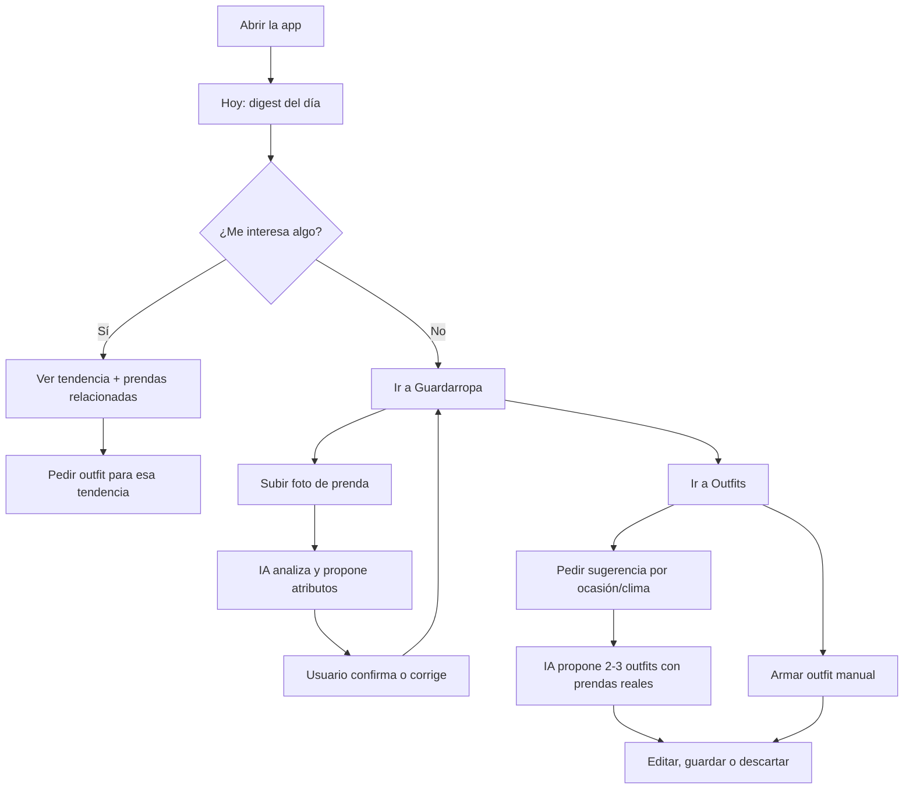
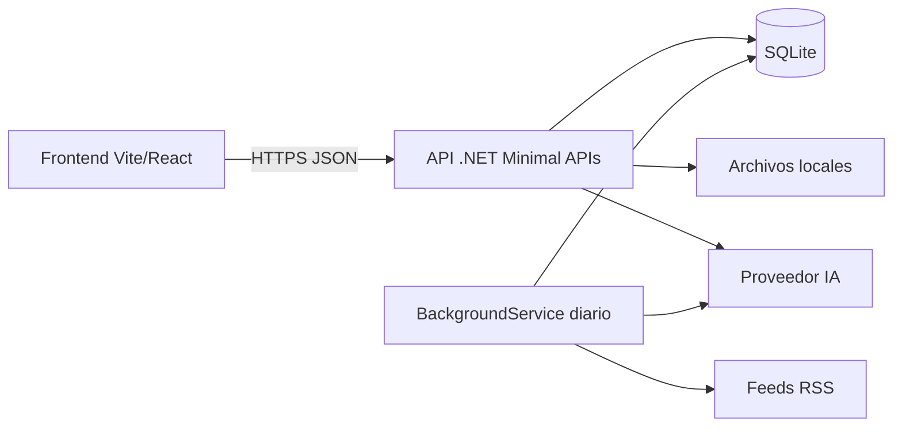

---
tags:
  - proyecto
  - moda
  - ia
  - portfolio
estado: diseño
fecha: 2026-11-07
---

# Fashion App (nombre provisional)

> Documento de diseño de un proyecto personal/portfolio. Reemplazar "Fashion App" por el nombre definitivo en el título y en la sección [[#Decisiones]].

## Índice

- [[#Visión]]
- [[#Problema]]
- [[#Usuario y casos de uso]]
- [[#Alcance del MVP]]
- [[#No-objetivos]]
- [[#Flujo principal]]
- [[#Arquitectura]]
- [[#Modelo de datos]]
- [[#IA y catalogación]]
- [[#Noticias y contenido]]
- [[#Rendimiento]]
- [[#Seguridad y privacidad]]
- [[#Testing y verificación]]
- [[#Roadmap]]
- [[#Riesgos]]
- [[#Decisiones]]
- [[#Bitácora]]

## Visión

Una app web personal que convierte tu guardarropa real en un sistema de estilo: muestra qué pasa en la moda hoy, cataloga tus prendas a partir de fotos y propone —o te deja armar— outfits con lo que ya tenés.

Nace como **proyecto personal/portfolio**. El objetivo no es escalar a un negocio, sino demostrar tres cosas en una sola pieza:

1. **Producto**: un flujo con criterio, no una demo técnica suelta.
2. **IA aplicada**: visión por computadora y generación estructurada resolviendo un problema real.
3. **Ingeniería**: backend C# limpio, rendimiento medido y decisiones documentadas.

**Éxito** = en la instancia personal, subir cinco prendas reales y ver un outfit armado con ellas en menos de tres minutos. En el link del portfolio, un visitante entiende el producto y ve el flujo completo en menos de un minuto, sin poder modificarlo.

## Problema

- La ropa se acumula, pero se usa siempre el mismo 20 %. La gente no ve combinaciones nuevas en lo que ya tiene.
- Las apps de inspiración muestran looks de terceros que no se pueden replicar porque no sabés qué prendas propias equivalen.
- Los feeds de tendencias están desconectados del guardarropa: informan, pero no accionan.
- Las apps de armario existentes suelen pedir carga manual extenuante (categoría, color, temporada) y por eso se abandonan.

**Hipótesis central**: si la tendencia del día se conecta con prendas concretas que ya tenés, aparece una razón para volver a abrir la app. El puente entre contenido y guardarropa es el diferencial del producto.

## Usuario y casos de uso

**Usuario único**: el dueño del guardarropa (uso personal). Perfil: 20–40 años, entra desde el celular, tiene 30–100 prendas y no quiere invertir tiempo catalogando.

Casos de uso del MVP:

1. Abrir la app y ver el **resumen de moda del día**.
2. **Subir una foto** de una prenda y confirmar los atributos que detectó la IA.
3. **Explorar el guardarropa** con filtros por categoría, color y temporada.
4. **Pedir outfits** para una ocasión y un clima, y recibir propuestas razonadas.
5. **Armar un outfit propio** eligiendo prendas del guardarropa.
6. **Guardar, editar y eliminar** outfits.

Fuera del MVP pero anticipado: colorimetría personal, recomendación de compras, probador virtual.

## Alcance del MVP

| Módulo | Incluye |
|---|---|
| **Hoy** | Digest diario de 6–10 noticias/tendencias, resumidas en español, con link a la fuente y relación con prendas propias cuando exista. |
| **Guardarropa** | Alta por foto, análisis automático, confirmación/edición de atributos, grilla con filtros, archivado y borrado. |
| **Outfits** | Sugerencia por IA según ocasión/clima, editor manual, guardado y favoritos. |
| **Plataforma** | Web responsive, un solo usuario, imágenes locales, job diario de noticias. |

Decisiones de alcance:

- **Sin autenticación multiusuario.** Un token de acceso simple por variable de entorno para la instancia personal.
- **Sin generación de imágenes de personas.** Los outfits se muestran como collage de las fotos reales de las prendas.
- **Sin tiempo real.** El digest se genera una vez al día; no hace falta websockets.

### Modo demo

El link del portfolio corre con `DEMO_MODE=true` y **nunca usa datos personales**:

- Al arrancar siembra un guardarropa de ejemplo (12–15 prendas de stock, con atributos ya cargados) y un digest de muestra si todavía no hay uno.
- **Es de solo lectura para el visitante**: no se pueden subir prendas, guardar outfits ni regenerar el digest. La UI oculta esas acciones y el backend las rechaza con `403`.
- **No hace llamadas a la IA.** El costo de la demo pública es cero y no hay riesgo de factura abierta.
- El análisis de prendas en vivo se muestra en el portfolio con un video/GIF grabado, no con una instancia writable.
- Reset: borrar solo el directorio de datos de la demo (`data/demo/`) y reiniciar el contenedor vuelve al estado sembrado. La instancia personal usa `data/` y es una copia separada con `DEMO_MODE=false` y token.
- **Aislamiento de datos**: la demo tiene su propio `Data:Root` (`data/demo`) y el backend se niega a arrancar si detecta que apunta a la base personal o si encuentra prendas que no pertenecen al manifiesto de ejemplo.

## No-objetivos

- Cuentas, registro, perfiles públicos ni funciones sociales.
- E-commerce, pagos, afiliados o recomendación de compra.
- Probador virtual / virtual try-on.
- App nativa iOS/Android (la web responsive alcanza).
- Recomendación de talles o medidas corporales.
- Multi-idioma: todo en español.
- Alta disponibilidad o multi-región; es un proyecto personal.

**Anti-objetivos** (harían fracasar el proyecto aunque funcione técnicamente):

- Que la app real dependa de datos de ejemplo para verse bien (el seed es solo para la demo pública).
- Un feed de noticias que son links sin resumen propio.
- Una app lenta en el celular por imágenes sin procesar.
- Un repositorio con decisiones explicadas solo en el código.

## Flujo principal



## Arquitectura

### Stack

| Capa | Elección | Por qué |
|---|---|---|
| Backend | **.NET 10 Minimal APIs** | Rápido de iterar, tipado fuerte, excelente para portfolio C#. |
| ORM / DB | **EF Core + SQLite** | Cero administración para uso personal; migraciones versionadas. |
| Frontend | **Vite + React + TypeScript** | La API ya es C#; no se necesita SSR. Bundle liviano y arranque rápido. |
| Estilos | **Tailwind CSS** | Iteración visual rápida y consistente. |
| Datos remotos | **TanStack Query** | Caché, reintentos y estados de carga sin boilerplate. |
| Ruteo | **React Router** | Tres vistas principales + detalle. |
| IA | **API multimodal hosted** (Gemini Flash o GPT-4o-mini) | Mejor relación costo/calidad para visión y salida estructurada. |
| Noticias | **Feeds RSS + BackgroundService** | Sin dependencias pagas; el job diario resume y guarda. |
| Imágenes | **Filesystem local** (`/data/uploads`) | Simple para uso personal; migrable a S3/R2 después. |
| Deploy | API en un VPS/contenedor con volumen; front estático en CDN | SQLite e imágenes necesitan disco persistente. |

### Diagrama



### Estructura del repositorio

```
fashion-app/
├─ backend/
│  ├─ FashionApp.Api/
│  │  ├─ Features/
│  │  │  ├─ Garments/        # endpoints, servicio, DTOs
│  │  │  ├─ Outfits/
│  │  │  └─ Digest/
│  │  ├─ Infrastructure/     # EF Core, IA, storage, RSS
│  │  ├─ Domain/             # entidades y enums
│  │  └─ Program.cs
│  └─ FashionApp.Tests/
├─ frontend/
│  ├─ src/
│  │  ├─ features/{digest,wardrobe,outfits}/
│  │  ├─ components/
│  │  ├─ lib/api.ts
│  │  └─ main.tsx
│  └─ vite.config.ts
├─ data/                     # sqlite + uploads (ignorado en git)
└─ docker-compose.yml
```

### Endpoints

| Método | Ruta | Función |
|---|---|---|
| GET | `/api/health` | Estado del servicio y de la DB. |
| GET | `/api/digest/today` | Digest del día (cacheado). |
| POST | `/api/digest/refresh` | Regenerar manualmente (requiere `ADMIN_SECRET`). |
| GET | `/api/garments` | Listado paginado con filtros (`category`, `color`, `season`, `cursor`). |
| POST | `/api/garments/analyze` | Sube la foto, la normaliza y devuelve una propuesta de atributos **sin crear la prenda**. |
| POST | `/api/garments/confirm` | Crea la prenda con los atributos confirmados por el usuario (sin llamar a la IA). |
| POST | `/api/garments` | Alta directa con imagen (compatibilidad; la UI usa analyze + confirm). |
| PATCH | `/api/garments/{id}` | Corregir atributos. |
| POST | `/api/garments/{id}/reanalyze` | Reintentar análisis. |
| DELETE | `/api/garments/{id}` | Archivar (baja lógica). |
| GET | `/api/config` | Configuración pública de la instancia (`demo`). |
| GET | `/api/outfits` | Listado de outfits guardados. |
| POST | `/api/outfits` | Crear outfit manual. |
| POST | `/api/outfits/suggest` | Sugerencia IA (`occasion`, `weather`). |
| PATCH | `/api/outfits/{id}` | Editar nombre, prendas o favorito. |
| DELETE | `/api/outfits/{id}` | Eliminar outfit. |

Convenciones: errores con `ProblemDetails`; validación con DataAnnotations o FluentValidation; respuestas paginadas con cursor opaco; el token de acceso se exige en un filtro, excepto `/api/health`, `/api/digest/today`, `/media/*` y, con `DEMO_MODE=true`, los endpoints de solo lectura.

## Modelo de datos

### Entidades

**Garment**

| Campo | Tipo | Notas |
|---|---|---|
| Id | GUID | PK |
| Name | string(120) | Detectado o corregido por el usuario |
| Category | enum | `top`, `bottom`, `dress`, `outerwear`, `shoes`, `bag`, `accessory` |
| Subcategory | string(60)? | Ej. "camisa", "jean recto" |
| ColorName | string(40) | Ej. "negro" |
| ColorHex | string(7) | Color dominante |
| SecondaryColors | string(200)? | JSON serializado |
| Pattern | string(40)? | `solid`, `striped`, `floral`… |
| Seasons | string(40) | Flags: `spring,summer,autumn,winter` |
| Formality | int | 1 (deportivo) a 5 (formal) |
| Material | string(60)? | |
| Brand | string(60)? | |
| StyleTags | string(300) | JSON con 0–4 valores de un vocabulario controlado (ver [[#IA y catalogación]]) |
| Notes | string(400)? | |
| ImagePath | string | Archivo original normalizado |
| ThumbPath | string | Miniatura 400 px |
| AnalysisJson | string | Respuesta cruda de la IA para auditar |
| Confidence | double | Confianza global del análisis |
| CreatedAt / UpdatedAt | DateTimeOffset | UTC |
| IsArchived | bool | Baja lógica |

**Outfit**

| Campo | Tipo | Notas |
|---|---|---|
| Id | GUID | PK |
| Name | string(120) | |
| Occasion | string(60)? | Ej. "trabajo", "cena" |
| Source | enum | `ai` / `manual` |
| Rationale | string(600)? | Explicación de la IA |
| IsFavorite | bool | |
| CreatedAt / UpdatedAt | DateTimeOffset | |

**OutfitItem** — PK compuesta (`OutfitId`, `GarmentId`), más `Layer` (int) y `SortOrder` (int).

**Digest** — `Id`, `Date` (único, solo fecha), `Summary`, `GeneratedAt`.

**DigestItem** — `Id`, `DigestId`, `Title`, `Url` (único), `Source`, `Summary`, `StyleTagsJson`, `ImageUrl?`, `PublishedAt`, `SortOrder`.

### Índices y configuración SQLite

- `Garment(Category)`, `Garment(CreatedAt DESC)`, `Garment(IsArchived)`.
- `Outfit(CreatedAt DESC)`, `Outfit(IsFavorite)`.
- `Digest(Date)` único; `DigestItem(Url)` único; `DigestItem(DigestId, SortOrder)`.
- `PRAGMA journal_mode=WAL`, `busy_timeout=5000`, `foreign_keys=ON`.
- `AsNoTracking()` y proyección a DTO en todas las lecturas; nada de cargar entidades completas para listados.

## IA y catalogación

### Alta de una prenda

1. El front envía la foto (JPEG/PNG/WebP, máx. 10 MB) a `POST /api/garments/analyze`.
2. El backend valida MIME real, límite de tamaño y decodifica la imagen.
3. **Normaliza**: corrige orientación, redimensiona a 1600 px de lado mayor y genera miniatura de 400 px en WebP. Elimina metadatos EXIF.
4. Calcula hash SHA-256 del archivo normalizado y lo guarda en el almacenamiento direccionado por contenido. Si ya existe una prenda activa con ese hash, devuelve su id y sus valores actuales.
5. Llama al modelo multimodal con la imagen y un prompt que exige **JSON estricto**.
6. Valida el JSON contra el esquema. Si falla, reintenta una vez con temperatura 0; si vuelve a fallar, devuelve atributos mínimos con `Confidence = 0` para corrección manual.
7. **No crea la prenda.** Devuelve la propuesta (`contentHash`, URLs de imagen, atributos y, si aplica, `currentGarment`).
8. El usuario confirma o edita y el front llama a `POST /api/garments/confirm` con `contentHash` + atributos. Ese endpoint crea la fila (o restaura una archivada) sin volver a llamar a la IA.
9. Si el usuario cancela, no queda ninguna fila; solo el archivo direccionado por contenido, que es reutilizable.

El análisis es **sincrónico** dentro de `POST /api/garments` (una prenda por request, timeout de 20 s). Es más simple que una cola y alcanza para el objetivo de tres minutos con cinco prendas. Si el proveedor tarda o falla, la prenda se guarda igual con `Confidence = 0` y el usuario puede reintentar con `POST /api/garments/{id}/reanalyze`.

`reanalyze` **no sobrescribe nada sin confirmación**: devuelve una propuesta con los atributos detectados y el front muestra el mismo formulario de confirmación que en el alta, con los valores actuales como base.

### Contrato de análisis

```json
{
  "name": "Camisa de lino beige",
  "category": "top",
  "subcategory": "camisa",
  "colors": [{ "name": "beige", "hex": "#D8C3A5", "share": 0.85 }],
  "pattern": "solid",
  "seasons": ["spring", "summer"],
  "formality": 3,
  "material": "lino",
  "styleTags": ["minimalista", "clasico"],
  "confidence": 0.86
}
```

### Vocabulario controlado de estilo

Tanto el análisis de prendas como el resumen de noticias usan **la misma lista cerrada** de etiquetas. Así la relación entre una tendencia y una prenda es una intersección exacta en SQL, no una comparación de texto libre.

```
minimalista · clasico · casual · streetwear · romantico · bohemio
deportivo · formal · vintage · noventoso · y2k · utilitario
monocromatico · colorido · oversized · entallado · capas · texturado
```

- El prompt de análisis elige 0–4 etiquetas de la lista; si el modelo devuelve otra cosa, se descarta.
- El prompt del digest asigna a cada noticia 1–3 etiquetas de la misma lista.
- La consulta de relación es `SELECT ... WHERE StyleTags LIKE '%"minimalista"%'` (o una tabla puente si crece). Si no hay coincidencias, la sección de prendas relacionadas no se muestra.

Reglas de análisis: si la imagen no contiene una prenda, devolver `{"error":"no_garment"}`. Si hay varias prendas, analizar la dominante y avisar con `"containsMultiple": true`.

### Sugerencia de outfits

- Entrada: ocasión, clima (opcional), y un resumen compacto del guardarropa (id, categoría, color, formalidad, temporada) — **no** se envían imágenes en esta llamada.
- **Clima**: selección manual en la UI (`frio`, `templado`, `calor`). Sin API ni geolocalización en el MVP; el valor se normaliza y forma parte de la clave de caché. Si se omite, se asume `templado`; un valor desconocido devuelve `400`.
- Salida estructurada: 2–3 outfits, cada uno con `name`, `itemIds`, `occasion` y `rationale`.
- **Validación de composición** (además de que los ids existan y no estén archivados):
  - Un outfit debe cubrir el torso y las piernas: o bien `top` + `bottom`, o bien un `dress`.
  - Calzado (`shoes`) es obligatorio.
  - `outerwear` es opcional y como máximo uno.
  - `bag` y `accessory` son opcionales y no limitados.
  - No se repite la misma prenda, ni hay dos `top`, dos `bottom` ni dos `dress`.
  - La formalidad de las prendas no puede diferir en más de 2 puntos entre sí.
- Si el modelo inventa un id o incumple una regla, se descarta el outfit; si no queda ninguno, se reintenta una vez y luego se cae a un generador por reglas (categoría + formalidad + temporada + clima) que aplica exactamente las mismas validaciones.
- El collage se renderiza en el front con las fotos reales; la IA nunca genera imágenes de personas.
- Costo estimado: centavos por sugerencia con modelos Flash/mini. Se cachea la última sugerencia por combinación de ocasión y clima.
- **Topes**: máximo 50 análisis de prendas y 20 sugerencias de outfit por día; el contador vive en SQLite. `/api/digest/refresh` exige un secreto de administrador separado (`ADMIN_SECRET`) y tiene un cooldown de 1 hora. Al superar un tope, `429` con `Retry-After`.

## Noticias y contenido

- **Fuentes**: 4–6 feeds RSS de medios de moda (Vogue, Business of Fashion, Hypebeast, Highsnobiety, blogs locales). Configurables en `appsettings`.
- **Job diario**: `BackgroundService` a las 07:00 (hora local configurable). Descarga feeds, deduplica por URL y por título normalizado, descarta ítems de más de 48 h.
- **Resumen**: se envían hasta 20 titulares al modelo para producir 6–10 ítems en español, cada uno con título corto, resumen de 2–3 líneas y 1–3 etiquetas del vocabulario controlado de estilo.
- **Regla legal/editorial**: se guarda título, resumen propio y link; nunca el cuerpo completo del artículo. La fuente se muestra siempre.
- **Persistencia**: se guarda un `Digest` por día. Si el job falla, se sirve el último disponible y se registra el error.
- **Conexión con el guardarropa**: se intersectan las etiquetas del ítem con `Garment.StyleTags` (misma lista cerrada). Es una consulta SQL, sin otra llamada de IA. Si no hay coincidencias, la sección de prendas relacionadas no se muestra.
- **Caché**: `GET /api/digest/today` responde con `ETag` y `Cache-Control: private, max-age=300`; el front además cachea con TanStack Query.

## Rendimiento

Presupuesto objetivo (p75 móvil): **LCP < 2,5 s · INP < 200 ms · CLS < 0,1**. API local: **p95 < 300 ms** en endpoints de lectura.

| Área | Medida |
|---|---|
| Imágenes | WebP/AVIF, miniatura 400 px en grillas, original solo en detalle, `loading="lazy"` salvo la imagen principal del digest (`fetchpriority="high"`). |
| Listados | Paginación por cursor; nunca devolver el guardarropa completo. |
| Consultas | Índices en filtros y orden; `AsNoTracking` + proyección; prohibido N+1 (verificar con logs de EF en desarrollo). |
| Bundle | Code splitting por ruta (`React.lazy`); Tailwind purgado; sin librerías de UI pesadas. |
| Caché | Digest diario cacheado en servidor y cliente; miniaturas con hash de archivo y `Cache-Control: immutable`. Assets estáticos con hash y caché larga. |
| IA | Llamada fuera del request de listado; timeout de 20 s con reintento único; hash de imagen para evitar análisis repetidos. |
| Red | JSON comprimido (Brotli/Gzip), `HttpClient` reutilizado, llamadas independientes en paralelo. |
| UI | Skeletons con layout estable en cargas > 300 ms; estados vacíos y de error explícitos; sin optimistic UI en acciones destructivas. |
| Fuentes | 2 pesos, `woff2`, `font-display: swap`, self-hosted. |
| Medición | Lighthouse y Web Vitals en desarrollo; tabla de línea base antes de la fase de pulido. |

Evitar explícitamente: SSR/SSG (no hace falta y agrega complejidad), virtualización prematura, Redis (SQLite + caché en memoria alcanzan), y micro-optimizaciones sin medición previa.

## Seguridad y privacidad

- **Instancia personal**: un **token de acceso** estático por variable de entorno, exigido por filtro; el front lo pide una vez y lo guarda en `sessionStorage`. No es autenticación real y así se documenta.
- **Instancia demo**: `DEMO_MODE=true` desactiva todos los endpoints de escritura y de IA; no requiere token porque solo expone lectura sobre datos sembrados.
- Validar tipo real de archivo por magic bytes, no por extensión; límite de 10 MB; nombres de archivo generados (nunca el nombre original).
- **Imágenes**: se sirven desde `/media/{hash}.webp`, con nombre derivado del hash del contenido. Son públicas pero no adivinables, sin listado de directorio, con `Cache-Control: public, max-age=31536000, immutable`. Esto permite `` sin cabecera `Authorization` y conserva la caché. El trade-off (quien tenga la URL puede ver la imagen) es aceptable para un proyecto personal y queda documentado.
- Eliminar EXIF (incluye geolocalización) antes de guardar y antes de enviar a la IA.
- Secretos solo en variables de entorno; `.env` y `data/` fuera de git.
- HTTPS obligatorio en producción. CORS restringido al origen del front.
- Aviso claro de que las fotos se envían a un proveedor externo de IA.
- Rate limit por IP en la instancia personal para `/api/garments` y `/api/outfits/suggest`.

## Testing y verificación

- **Backend**: xUnit + `WebApplicationFactory`; tests de integración sobre SQLite en memoria o archivo temporal para garments, outfits y digest (incluye ids inválidos de IA y JSON malformado).
- **Frontend**: Vitest para lógica de filtros y composición; Playwright para el flujo crítico (subir prenda → confirmar → pedir outfit → guardar).
- **IA**: los tests no llaman al proveedor real; se usa un fake que devuelve respuestas grabadas.
- **Verificación de entrega**: `dotnet build`, `dotnet test`, `npm run build`, `npm run test`, Lighthouse móvil y recorrido manual del flujo completo.

## Roadmap

| Fase | Entregable | Criterio de salida |
|---|---|---|
| **0. Base** | Repo, Docker Compose, SQLite, health check, front con layout de tres secciones. | La app levanta y navega vacía sin errores. |
| **1. Guardarropa** | Alta con foto, análisis IA, confirmación, grilla y filtros. | Subir 10 prendas reales y encontrarlas todas con atributos correctos. |
| **2. Outfits** | Sugerencia IA validada, editor manual, guardado y favoritos. | Se generan outfits solo con prendas existentes y se pueden editar. |
| **3. Hoy** | Job RSS, resumen diario, relación con prendas, caché. | El digest aparece al abrir la app y sobrevive a un reinicio. |
| **4. Portfolio** | Pulido visual, datos de ejemplo, README con capturas, deploy y métricas. **Cerrada en código y verificación local** (2026-11-09). | Link público funcionando y Lighthouse móvil en verde. |

> **Estado de la Fase 4:** cerrada en implementación y verificación local. El
> deploy real (app, volumen y build en Fly.io) queda como handoff del dueño
> porque este entorno no tiene `flyctl` ni credenciales. La verificación local
> está en [[smoke]] y el cierre incluye 265 tests backend, 51 frontend y 11 E2E.
> El LCP de 3,21 s no cumple el presupuesto de 2,5 s y se acepta como deuda
> documentada en [[perf-followup]].

> Plan detallado de la Fase 0–1: [[Fashion App - Plan Fase 0-1]]
>
> Plan detallado de la Fase 2 (outfits): [[Fashion App - Plan Fase 2]] — **implementada y verificada**.
>
> Plan detallado de la Fase 3 (Hoy): [[Fashion App - Plan Fase 3]] — **implementada y verificada**. Sigue la Fase 4 (portfolio/deploy).

## Riesgos

| Riesgo | Impacto | Mitigación |
|---|---|---|
| El análisis de prendas es impreciso | Guardarropa inútil; se pierde la confianza | Confirmación humana obligatoria, edición fácil, confianza visible, reintento. |
| Costo o cuota de la IA | La demo se cae o cuesta dinero | Cache por hash, límites diarios, modelo Flash/mini, fake en tests. |
| Feeds RSS cambian o se rompen | "Hoy" queda vacío | Varias fuentes, último digest como fallback, errores visibles en logs. |
| Licencias de contenido | Riesgo legal si se copia de más | Solo título, resumen propio y link; atribución siempre. |
| SQLite en deploy con volumen | Pérdida de datos o bloqueo | WAL, backups del archivo, un solo proceso de escritura. |
| Scope creep (colorimetría, compras, social) | Nunca se termina el MVP | Lista de no-objetivos explícita; cada idea nueva va a "después del MVP". |
| Dependencia de un solo proveedor de IA | Cambios de precio o API | Interfaz `IVisionModel` / `ITextModel`; el proveedor es reemplazable. |

## Decisiones

| # | Decisión | Alternativa descartada | Razón |
|---|---|---|---|
| 1 | Proyecto personal/portfolio | Producto comercial | Permite alcance acotado y foco en demostrar criterio. |
| 2 | Web responsive (SPA) | App nativa | Un link alcanza para el portfolio; menos costo de distribución. |
| 3 | Vite + React + TypeScript | Next.js | La API ya es C#; no se necesita SSR ni SEO. |
| 4 | .NET 10 Minimal APIs | FastEndpoints / controllers | Menos ceremonia, lectura clara, sin dependencias extra. |
| 5 | EF Core + SQLite | PostgreSQL | Cero administración para uso personal; migrable después. |
| 6 | IA hosted multimodal | Modelos locales CLIP/SAM | Calidad inicial muy superior con mucho menos trabajo. |
| 7 | RSS + job diario | Curaduría manual / API paga | Gratis, automatizable y suficiente para 6–10 ítems. |
| 8 | Outfits como collage de fotos reales | Generación de imágenes de personas | Evita problemas éticos, de realismo y de costo. |
| 9 | Un solo usuario con token simple | Auth completa | No aporta al objetivo de portfolio en el MVP. |
| 10 | Digest conecta tendencia con prendas por tags | Segunda llamada de IA para relacionar | Más barato, determinista y suficiente. |
| 11 | Demo pública **de solo lectura** con prendas de ejemplo | Demo writable con límites | Cero costo de IA, cero riesgo de datos personales y cero mantenimiento de estado. |
| 12 | `StyleTags` con vocabulario cerrado | Temas libres generados por la IA | Permite relacionar tendencia y prenda con una intersección SQL confiable. |
| 13 | Imágenes en `/media/{hash}` públicas y no adivinables | URLs firmadas por request | `` funciona sin token y se mantiene la caché inmutable; el riesgo se acepta y documenta. |
| 14 | Análisis sincrónico por prenda | Cola de trabajos | Menos piezas; cinco prendas se procesan en menos de un minuto. |
| 15 | Reanálisis con confirmación | Sobrescritura automática | Nunca pisa correcciones manuales. |
| 16 | Clima manual (frío/templado/calor) | API meteorológica o geolocalización | Elimina una integración y sus estados de error; no cambia la demo. |
| 17 | Topes diarios + `ADMIN_SECRET` para refresh | Confiar en el uso personal | Evita una factura abierta y un endpoint sensible expuesto. |
| 18 | Magick.NET-Q8-AnyCPU para imágenes | ImageSharp 4 | Apache 2.0 y `dotnet publish -c Release` funciona sin clave; ImageSharp bloquea el build Release sin licencia. |
| 19 | Flujo analyze → confirm | Crear la prenda al subir la foto | Evita prendas huérfanas si el usuario cancela y respeta la confirmación del usuario. |
| 20 | Un solo `Data:Root` para base e imágenes | Rutas separadas | Backup, reset y privacidad en un único directorio; la demo usa `data/demo`. |
| 21 | Fail-fast en producción sin token o con IA fake | Arrancar igual | Evita exponer el guardarropa o servir análisis falsos por un descuido de configuración. |
| 22 | Vestido exclusivo: no se combina con top ni bottom | Permitir layering | El spec dice "o bien top + bottom, o bien un vestido"; la regla queda determinista y testeada. |
| 23 | Caché de sugerencias antes de consumir cuota | Consumir cuota primero | Una respuesta cacheada no cuesta IA ni gasta el presupuesto diario. |
| 24 | Rate limit por IP configurable + clima opcional | Sin rate limit / clima obligatorio | El spec pide ambos; el clima faltante usa `templado` y un valor desconocido sigue siendo `400`. |
| 25 | Fallback por reglas cuando la IA no devuelve outfits válidos | Devolver error | La sugerencia siempre responde algo útil; el usuario nunca ve un 500 por una respuesta mala del modelo. |
| 26 | Demo siembra un digest de muestra y no arranca el job diario | Generar el digest con IA en la demo | La portada pública funciona sin costo, sin feeds y sin riesgo de datos personales. |
| 27 | El validador descarta notas sin título o sin resumen | Aceptar links sin resumen | El anti-objetivo del spec prohíbe un feed de links vacíos. |
| 28 | El cooldown de refresh se libera si la generación lanza una excepción | Mantener el bloqueo una hora | Un fallo del proveedor no debe impedir reintentar cuando el servicio vuelve. |
| 29 | Rate limit por IP real detrás del proxy: `Fly-Client-IP`, luego el primer `X-Forwarded-For`, luego la dirección del socket | Particionar por `RemoteIpAddress` | Fly termina TLS y el socket es el edge: sin resolver, todos los visitantes comparten un bucket. La Machine debe quedar accesible solo por el proxy, porque esos headers se falsifican en una conexión directa. |
| 30 | Aceptar el LCP local de 3,21 s como deuda documentada de la Fase 4 | Reescribir el hero en esta ola | El resto del presupuesto se cumple (CLS 0,060; TBT 42–55 ms) y la causa del LCP todavía es una hipótesis; se prioriza cerrar deploy, demo, CI y documentación. La medición y el criterio de salida quedan en [[perf-followup]]. |

## Bitácora

| Fecha | Nota |
|---|---|
| 2026-11-07 | Documento de diseño creado. Stack y alcance del MVP acordados. |
| 2026-11-07 | Demo pública definida como solo lectura, con prendas de ejemplo y sin llamadas a la IA. Datos personales solo en instancia local. |
| 2026-11-07 | Diseño aprobado. Plan de implementación de la Fase 0–1 escrito en [[Fashion App - Plan Fase 0-1]]. |
| 2026-11-07 | ImageSharp reemplazado por Magick.NET (Apache 2.0) porque la versión 4 bloquea el publish Release sin licencia. |
| 2026-11-07 | Fase 0–1 implementada y verificada: 91 tests backend, 19 frontend, 8 E2E, build y lint limpios. Flujo final analyze → confirm, data root unificado y demo aislada. |
| 2026-11-08 | Fase 2 implementada y verificada: outfits con ítems, reglas de composición, CRUD manual, sugerencias IA con validación, fallback por reglas, cuota por tipo y caché; panel de sugerencias, collage y edición en el front. 192 tests backend, 46 frontend y 10 E2E en verde. |
| 2026-11-08 | Fase 3 implementada y verificada: digest diario desde RSS, resumen con IA validada, portada Hoy, matching por `StyleTags`, ETag, job diario y refresh admin con cooldown. 247 tests backend, 51 frontend y 11 E2E en verde. |
| 2026-11-09 | Fase 4 cerrada en código y verificación local: SPA servida por la API, contenedor/compose, `fly.toml` y handoff de deploy, CI, capturas, video del flujo subir → analizar → confirmar y README final. Suite: 265 tests backend (254 previos + 11 de rate limit/caché), 51 frontend y 11 E2E; lint y build limpios. Smoke de producción local en [[smoke]]. El rate limit resuelve `Fly-Client-IP` → primer `X-Forwarded-For` → socket y la Machine debe quedar solo detrás del proxy de Fly. El LCP de 3,21 s se acepta como deuda documentada en [[perf-followup]]; el deploy real queda como handoff del dueño (sin credenciales en este entorno). |
