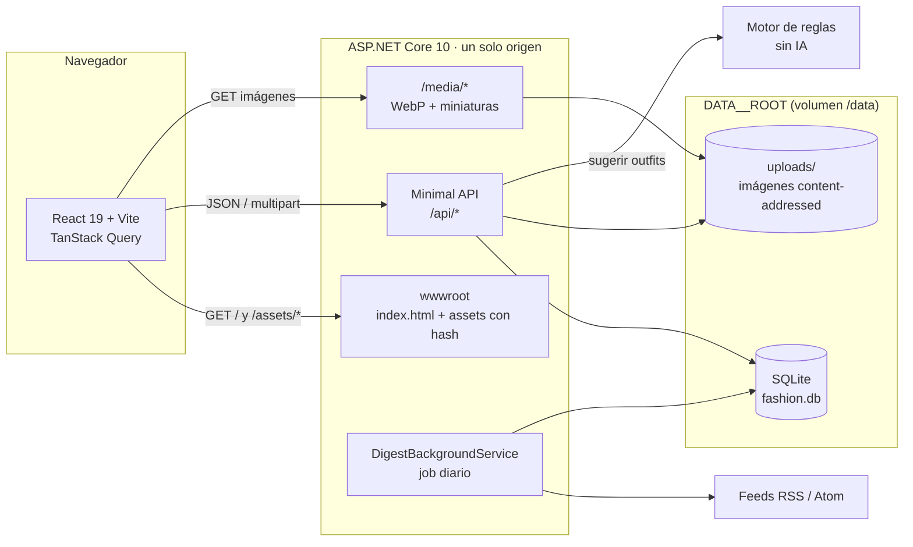
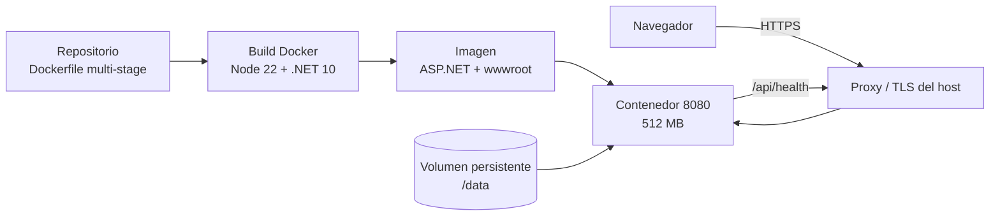

# Arquitectura

Fashion App es una aplicación web de un solo dueño: un frontend React que
consume una API .NET y guarda todo en un único directorio de datos (SQLite +
imágenes). En producción la API sirve también la SPA compilada, así que hay
**un solo origen** y un solo contenedor.

El diseño completo está en el [spec](Fashion%20App.md#arquitectura); este
documento resume cómo se conectan las piezas y por qué.

## Vista general



- **SPA**: React 19 + Vite, ruteo con React Router y caché de servidor con
  TanStack Query. Las rutas se cargan con `React.lazy`, así que la portada no
  descarga el guardarropa ni los outfits.
- **API**: Minimal APIs de .NET 10 con EF Core 10 sobre SQLite. Expone
  `/api/garments`, `/api/outfits`, `/api/digest`, `/api/config` y
  `/api/health`.
- **Imágenes**: Magick.NET normaliza cada foto a WebP, elimina EXIF y genera
  una miniatura de 400 px. El nombre es el hash del contenido, así que subir
  dos veces la misma foto no duplica archivos ni prendas.
- **Job de noticias**: un `BackgroundService` corre todos los días a
  `DIGEST__RUNAT` (07:00 local), lee los feeds configurados, arma el resumen
  local con el texto del feed y etiquetas por palabras clave, y guarda un digest
  por fecha. La portada **Hoy** lo consume con `ETag`/`304`.
- **Outfits**: un motor determinista de reglas y armonía de color arma las
  combinaciones; no hay proveedor de IA ni llamadas externas.

## Un solo origen en producción

| Ruta | Quién responde | Caché |
|---|---|---|
| `/` y rutas de la SPA (`/guardarropa`, `/outfits`, …) | `index.html` del `wwwroot` | `no-cache` |
| `/assets/<hash>.js` y `<hash>.css` | archivos estáticos | `public, max-age=31536000, immutable` |
| `/api/*` | Minimal API | según el endpoint (`private` en el digest con prendas) |
| `/media/*.webp` | archivos estáticos de uploads | inmutable |

La prioridad importa: `/api/*` y `/media/*` se resuelven antes del fallback de
la SPA. Una ruta desconocida de la API devuelve `404` aunque `wwwroot` exista,
y una ruta desconocida de la SPA sirve `index.html` para que el router del
cliente muestre la pantalla correcta.

## Datos y aislamiento de la demo

`DataPaths` resuelve **una única raíz** al arrancar y deriva de ella la base y
los uploads:

```
DATA__ROOT/
├── fashion.db
└── uploads/
    ├── <hash>.webp
    └── <hash>-thumb.webp
```

Con `DEMO__ENABLED=true`, la raíz activa pasa a ser `DEMO__DATAROOT`
(`/data/demo` en el contenedor). Antes de arrancar, la app rechaza la
configuración si esa raíz coincide con la base o los uploads personales, y el
seeder verifica que todas las prendas de la base pertenezcan al manifiesto de
demo. Así una demo pública nunca puede leer ni borrar datos personales.

| | Demo pública | Instancia personal |
|---|---|---|
| `DEMO__ENABLED` | `true` | `false` |
| Datos | `DATA__ROOT/demo` | `DATA__ROOT` |
| Token | no hace falta | `APP__TOKEN` obligatorio en `Production` |
| Outfits | motor de reglas | motor de reglas |
| Feeds / digest | fake, sembrado; sin job | RSS real y job diario |
| Escrituras | `403` (solo lectura) | permitidas con token |
| Costo | cero | cero (sin IA) |

## Deploy



- La imagen final corre como usuario `app`, escucha en `8080` y monta el
  volumen de datos en `/data`; un redeploy no borra la demo.
- El host de contenedores debe terminar TLS y enviar `X-Forwarded-For`. No hay
  configuración de proveedor ni credenciales versionadas en el repo.

## Tests

- **Backend**: xUnit + `WebApplicationFactory` sobre SQLite en memoria o un
  archivo temporal; nunca tocan `data/`.
- **Frontend**: Vitest + Testing Library para reglas, formularios y páginas.
- **E2E**: Playwright levanta la API y Vite desde `frontend/playwright.config.ts`
  con `.test-data` aislado, IA y feeds fake, y un token vacío. Los specs de
  outfits y digest siembran prendas por API para no depender del diálogo de
  alta.
- **Capturas**: `frontend/tests/screenshots.spec.ts` se salta salvo
  `CAPTURE=1`; siembra el guardarropa y el digest, y guarda las imágenes de
  portfolio en `docs/screenshots/`.

## Decisiones clave

- **SPA y API en el mismo origen.** Evita CORS en producción y permite que un
  solo contenedor sirva todo; `/api/*` y `/media/*` mantienen prioridad sobre
  el fallback de `index.html`. Ver [plan de la Fase 4](plan-fase-4.md#task-1-spa-servida-por-la-api-y-caché-de-estáticos).
- **Raíz de datos única.** SQLite y uploads derivan de `DATA__ROOT`, así que
  mover el volumen mueve toda la instancia. Está en la sección **Seguridad y
  privacidad** del [spec](Fashion%20App.md#seguridad-y-privacidad).
- **Demo aislada y de solo lectura.** Una raíz distinta, un seeder propio y
  `403` en las escrituras hacen que la demo pública no pueda convertirse en
  una base personal. Ver [plan de la Fase 4](plan-fase-4.md#global-constraints).
- **Alta en dos pasos: analizar → confirmar.** El análisis no crea filas; si
  el usuario cierra el diálogo solo quedan archivos reutilizables. Ver
  **Decisiones** en el [spec](Fashion%20App.md#decisiones).
- **La IA propone, el validador decide.** Ids, URLs y etiquetas fuera del
  vocabulario cerrado se descartan antes de persistir; las imágenes se
  normalizan siempre. Ver **IA y catalogación** en el
  [spec](Fashion%20App.md#ia-y-catalogación).
- **Privacidad del guardarropa en la portada.** Las prendas relacionadas con
  una noticia solo se incluyen si la instancia no tiene token o el request
  trae uno válido; la respuesta es `Cache-Control: private` y
  `Vary: X-App-Token`.
- **Proveedores fake en tests.** Ni el CI ni el E2E llaman a Gemini o a feeds
  reales; la demo también usa fake para tener costo cero. Ver
  [plan de la Fase 4](plan-fase-4.md#task-4-ci-de-github-actions).
- **Rendimiento como presupuesto.** LCP < 2,5 s, INP < 200 ms y CLS < 0,1 en
  p75 móvil; lecturas de API p95 < 300 ms. Las mediciones reales están en el
  [README](../README.md#rendimiento).
